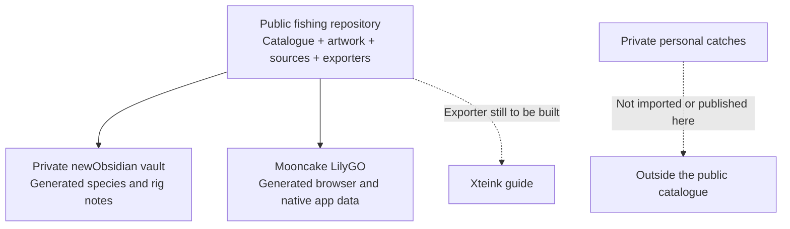
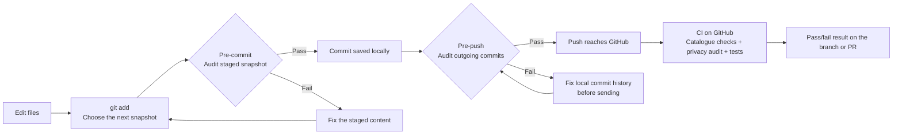

# Fishing

A shared fishing catalogue: **28 species, nine tackle topics and 37 illustrations**. It holds reference facts, artwork, source links and tools that turn them into app data or Obsidian notes. Freshwater yabby is included.

It does **not** hold personal catches, private fishing locations, vault notes, credentials or device backups. Those stay in their private stores.

## What this repository owns



Think of this repo as the shared ingredients. Obsidian and LilyGO decide how to present them. They consume a chosen version of the catalogue; a change here does not automatically update an installed board.

| Part | Where it lives | Its job |
| --- | --- | --- |
| Species, rules and tackle facts | `catalogue.json` | Shared reference content, with per-entry review dates |
| Creature images and rig diagrams | `artwork/` | Reusable illustrations and their provenance |
| Note exporter | `scripts/export_obsidian.py` | Generate reference notes and image copies in a chosen vault |
| Obsidian appearance | The private vault's theme and CSS snippets | Style the notes, headings, panels and surrounding app |
| LilyGO appearance and controls | The Mooncake LilyGO app repository | Draw the screen and handle the dial |
| Personal catches | Private app/vault storage | Record your catches without publishing them here |

### Does Fishing have its own styling?

**It has shared artwork, but no standalone app theme or CSS.** GitHub renders this README and its diagrams. The pale-blue fishing-note appearance belongs to the private Obsidian vault; the sage pixel screens belong to LilyGO. Both can use the same species facts and pictures while looking different.

The raw catalogue can be checked out inside a private vault without making that vault public: the checkout has its own Git history and public remote. Keep private notes outside that checkout. See [publishing checks](SECURITY.md).

## Three checkpoints: pre-commit, pre-push and CI

A **commit** saves a checkpoint on your computer. A **push** sends commits to GitHub. **CI** means continuous integration: automated checks run on GitHub when code is pushed or a pull request changes.



| Checkpoint | When and where? | What does ours check? | What happens if it fails? |
| --- | --- | --- | --- |
| **Pre-commit** | On your computer, when you run `git commit` | The complete staged snapshot: approved file paths, reference data and common private-data/secret patterns | The commit is stopped. Fix the staged content and try again. |
| **Pre-push** | On your computer, before `git push` sends commits | Every outgoing commit's snapshot, including earlier commits in the history being sent | The push is stopped before those commits are uploaded. Fix the local history first. |
| **CI** | On GitHub, after a push or pull-request event | Catalogue/artwork consistency, the pushed HEAD snapshot's privacy audit, exporter checks and six audit tests | GitHub reports a failed run. It does not undo the push. |

### Why do we need all three?

**Pre-commit catches mistakes early.** Suppose you accidentally stage a personal note alongside a species update. Its unapproved path is rejected before the local checkpoint is saved. The audit reads what you staged, not just what your editor currently shows.

**Pre-push catches mistakes across history.** Suppose a private file got into one local commit, and you deleted it in the next. The latest files look clean, but pushing both commits would still publish the earlier copy. Our pre-push audit checks both commits and stops that push. Deleting the file in a later commit is not enough.

**CI gives everyone a repeatable check on GitHub.** Local hooks are not installed automatically by cloning and can be bypassed. CI runs in a fresh environment and records a visible pass/fail result. It is a second line of checking, **not a way to prevent the first upload of a secret**. Preventing that upload is why the local pre-push check matters.

Passing these checks does not automatically merge a PR, install firmware, verify every fishing rule or prove an illustration's anatomy. CI only blocks merging if the repository's merge rules require it. New text and artwork still need human review.

### Enable the local checks after cloning

```sh
python scripts/install_hooks.py
```

This enables this checkout's pre-commit and pre-push hooks. Repeat it for each new clone. The hooks reject unexpected paths, catch/location/credential fields, common token/private-key patterns and local user paths. A failure names the category or file without printing a secret value. See [the exact scope and limits](SECURITY.md).

If a hook fails, do not bypass it: inspect the staged files or outgoing commits, remove the private/unrelated content and retry. If a secret has already reached GitHub, deleting the visible file is not sufficient; rotate the credential and follow the appropriate history-removal process.

## Use and update the catalogue

Edit `catalogue.json` for shared facts and `artwork/` for visuals. Each species keeps its own `checked` review date and source links. Adding a species does not redate the whole collection. See [sources](SOURCES.md), [authoring](AUTHORING.md) and [licences](LICENSE.md).

LilyGO consumes a pinned checkout of this repository and generates its browser/native data and artwork. Obsidian can use the same checkout:

```sh
python scripts/export_obsidian.py --vault /path/to/vault
python scripts/check.py
python scripts/test_audit.py
```

The exporter writes reference notes and images under `Hobbies/Fishing/`; it preserves generated-note frontmatter and refuses to overwrite handwritten Species/Rigs notes. It does not read, import or export personal catch records. Device installation and Xteink export are separate operations.
